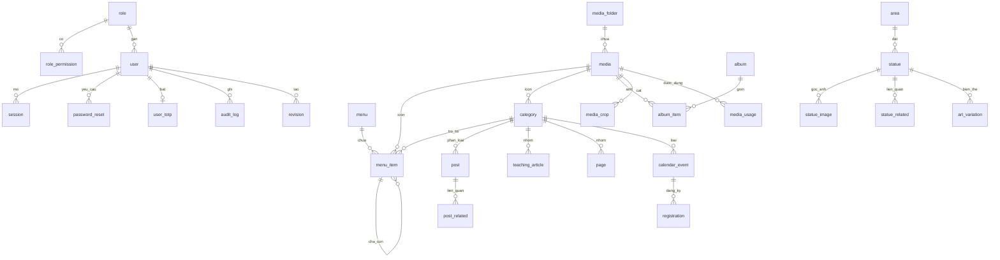

# Kiến trúc Admin CMS cho tunglamhoaphuc.com

Ngày lập: 21/11/2026. Trạng thái: **chờ duyệt (Checkpoint 2)**. Chưa có dòng mã nào được viết theo tài liệu này.

Đầu vào: [site-inventory.md](site-inventory.md). Quyết định của chủ dự án ngày 21/11/2026: đăng nhập bằng mật khẩu, 2FA có sẵn nhưng không bắt buộc.

Tài liệu này thay thế các quyết định về admin trong `tasks/plan.md` (T27–T38) ở những điểm nêu tại mục 9. Sau khi được duyệt, `tasks/plan.md` và `tasks/todo.md` sẽ được cập nhật theo.

## 1. Mục tiêu và giả định

**Mục tiêu.** Ban biên tập của chùa tự quản lý toàn bộ nội dung trang công khai (menu, bài viết, ảnh, lịch, bảo tượng, trang chủ, cấu hình) mà không cần sửa mã hay deploy lại, với phân quyền chi tiết và nhật ký đầy đủ.

**Giả định tôi đang dùng.** Nếu điểm nào sai, cần sửa trước khi viết mã:

1. Admin nằm chung ứng dụng với trang công khai (cùng Worker `tlhp-web`, cùng D1 `tlhp-db`, cùng R2 `tlhp-media`). Không dựng máy chủ riêng.
2. Đăng nhập chỉ bằng email + mật khẩu. Cloudflare Access không còn là cửa bắt buộc của admin mới.
3. 2FA (TOTP) do từng tài khoản tự bật; mặc định tắt. Super Admin có thể đặt lại 2FA của người khác nhưng không bắt buộc ai bật.
4. Trang công khai giữ nguyên giao diện. Những trường mới chưa có chỗ hiển thị (Ban biên tập, nhiều góc ảnh bảo tượng, nguồn trích dẫn) được lưu và quản lý trong admin; việc hiển thị ra ngoài là bước riêng, làm khi được yêu cầu.
5. Khi một module admin mới đi vào dùng thật, dữ liệu của module đó không còn được nhập lại từ admin cũ (xem mục 8.4).
6. Một người dùng có đúng một vai trò.

## 2. Tech stack

Đồng bộ theo những gì repo đang chạy. Chỉ thêm thư viện ở chỗ repo chưa có lời giải.

| Tầng | Lựa chọn | Lý do |
|---|---|---|
| Nền chạy | Cloudflare Workers, vinext 1.4 (Next.js 16 App Router), React 19 | đang dùng |
| CSDL | Cloudflare D1 (SQLite) + drizzle-orm 0.45, migration bằng drizzle-kit | đang dùng |
| Lưu tệp | Cloudflare R2 `tlhp-media` | đang dùng |
| API | REST, Route Handlers dưới `/api/quan-tri/v1/*`, kiểm dữ liệu vào bằng zod 4 | zod đã có; REST cho phép kiểm thử 403 trực tiếp |
| Giao diện admin | React + Bootstrap 5 + SCSS (`_admin.scss`), TypeScript | cùng hệ thiết kế với trang; đã chốt không dùng Tailwind |
| Trình soạn thảo | TipTap 2 (StarterKit, Table, Image, Link, YouTube, Placeholder + node tự viết cho audio, trích dẫn kinh/thơ, ảnh có chú thích) | đã chốt trong kế hoạch cũ |
| Kéo-thả | `@dnd-kit/core`, `@dnd-kit/sortable` | cây menu, sắp thứ tự |
| Cắt ảnh | `react-image-crop`, nén WebP bằng canvas của trình duyệt | `sharp` không chạy trong Worker |
| Băm mật khẩu | Argon2id qua `@noble/hashes` (m = 19 MiB, t = 2, p = 1 theo khuyến nghị OWASP) | yêu cầu đề bài. Bản thuần JavaScript, vì các bản WebAssembly biên dịch mã lúc chạy mà Workers không cho phép. Đo trên Node: khoảng 0,22 giây |
| Token | `jose` (JWT HS256 cho access token) | chuẩn, chạy trên WebCrypto |
| TOTP | Tự viết trên WebCrypto (HMAC-SHA1, RFC 6238), mã QR bằng `qrcode` | khoảng 40 dòng, không cần thư viện |
| Gửi thư | SMTP qua TCP socket của Workers (`cloudflare:sockets`), thư viện `worker-mailer` | Workers mở được SMTP ở cổng 465/587; cổng 25 bị chặn |
| So sánh phiên bản | `diff` (jsdiff) | xem diff giữa hai bản |
| Thư viện icon | `lucide-static` (khoảng 1.500 icon SVG) + 63 icon `tji-*` sẵn có | có ô tìm kiếm theo tên |
| Kiểm thử | Vitest (đơn vị, tích hợp với D1 giả lập), Playwright (đầu-cuối) | đang dùng |

Các thư viện mới cần thêm: TipTap, dnd-kit, react-image-crop, @noble/hashes, jose, qrcode, worker-mailer, diff, lucide-static. `worker-mailer` sẽ được chạy thử trên Workers thật ở task đầu tiên trước khi các module khác phụ thuộc vào.

**Đính chính so với báo cáo Checkpoint 1:** tôi đã viết rằng Workers không mở được kết nối SMTP. Điều đó sai. Workers hỗ trợ TCP socket đi ra nên gửi SMTP được qua cổng 465 hoặc 587.

### 2.1 Điều kiện tiên quyết: Workers Paid

Gói Workers Free giới hạn 10 ms CPU mỗi request. Một lần băm Argon2id với tham số trên tốn khoảng 50–150 ms CPU. Trang công khai vốn đã có request bị `exceededCpu` trên gói Free.

Vì vậy **đăng nhập bằng mật khẩu chỉ chạy ổn định khi tài khoản có Workers Paid** (5 USD/tháng, 30 giây CPU mỗi request). Việc mua gói là quyết định của chủ tài khoản; tôi không thay đổi thanh toán. Trong lúc phát triển, mọi thứ chạy và kiểm thử được trên máy cục bộ vì trình giả lập không áp giới hạn CPU.

Tôi không đề xuất hạ tham số băm để lách giới hạn: mật khẩu băm yếu là rủi ro lớn hơn khoản phí.

## 3. Bản đồ module

| Mã module | Trách nhiệm | Phụ thuộc |
|---|---|---|
| `nen-tang` | Migration, khung API (lỗi, phân trang, zod), khung giao diện admin, tiện ích slug | |
| `tai-khoan` | Đăng nhập, phiên, quên mật khẩu, 2FA, người dùng, vai trò, quyền | `nen-tang` |
| `nhat-ky` | Audit log, thùng rác, lịch sử phiên bản (dịch vụ dùng chung) | `tai-khoan` |
| `media` | Tải lên, thư mục, cắt ảnh, thay ảnh giữ ID, ảnh không dùng, dung lượng | `nhat-ky` |
| `chi-muc` | Chuyên mục, cây menu, icon | `media` |
| `bai-viet` | Bài viết, bài tông chỉ, trang giới thiệu, TipTap, luồng duyệt, xem trước | `chi-muc`, `media` |
| `dac-thu` | Trang chủ, lịch và sự kiện, bảo tượng, khu vực, Lời Thầy dạy | `bai-viet` |
| `van-hanh` | Dashboard, SEO, redirect 301, cấu hình, SMTP, sao lưu | các module trên |

Thứ tự xây: `nen-tang` → `tai-khoan` → `nhat-ky` → `media` → `chi-muc` → `bai-viet` → `dac-thu` → `van-hanh`. Kiểm thử đầu-cuối (Pha 4) chạy sau cùng, nhưng mỗi module có kiểm thử tích hợp riêng ngay khi viết.

## 4. Cấu trúc thư mục

```
src/app/quan-tri/                    Giao diện admin (noindex)
  (auth)/dang-nhap, quen-mat-khau, dat-lai-mat-khau, xac-thuc-2-buoc
  (khung)/layout.tsx                 Khung có menu trái, kiểm phiên
  (khung)/page.tsx                   Dashboard
  (khung)/bai-viet, chi-muc, menu, media, trang-chu, lich-tu-hoc,
          bao-tuong, khu-vuc, loi-thay-day, tai-khoan, vai-tro,
          nhat-ky, thung-rac, seo, cau-hinh, sao-luu, ho-so
  xem-truoc/[loai]/[id]              Xem trước bằng component của trang thật
src/app/api/quan-tri/v1/             REST API
src/admin/                           Mã phía máy chủ của admin
  auth/        mật khẩu, phiên, token, totp, giới hạn tần suất
  rbac/        danh mục quyền, hàm requirePermission
  audit/       ghi nhật ký, phiên bản, thùng rác
  media/       tải lên R2, thay ảnh, quét ảnh đang dùng
  mail/        SMTP, mẫu thư
  http/        khung route handler, lỗi, phân trang
  <module>/    schema zod + truy vấn drizzle của từng module
src/components/admin/                Component giao diện admin
src/db/schema.ts                     Schema (mở rộng)
migrations/0001_admin-*.sql          Migration mới
scripts/seed-admin.ts                Tạo vai trò mẫu và Super Admin đầu tiên
tests/unit/admin/, tests/e2e/admin/  Kiểm thử
```

**Đường dẫn admin là `/quan-tri`, không phải `/admin`.** `next.config.js` đang chuyển `/admin`, `/login`, `/van-hanh` về admin cũ; giữ nguyên để admin cũ còn dùng được trong lúc chuyển tiếp.

`robots.ts` thêm `Disallow: /quan-tri` và `/api/` đã bị chặn sẵn. Mọi phản hồi dưới `/quan-tri` và `/api/quan-tri` mang `X-Robots-Tag: noindex` và `Cache-Control: no-store`.

## 5. Thiết kế CSDL

### 5.1 Nguyên tắc

- Giữ 24 bảng hiện có và khóa chính dạng chuỗi. Bản ghi mới dùng id dạng `<loại>-<ULID>`.
- Mọi thay đổi đi qua migration mới (`0001…`), không sửa `0000_khoi-tao.sql`.
- Thời gian lưu dạng chuỗi ISO 8601 UTC (`2026-11-21T07:30:00Z`).
- Bảng nội dung có thể xóa mềm mang 2 cột `deleted_at`, `deleted_by`. Mọi truy vấn của trang công khai và danh sách admin lọc `deleted_at IS NULL`.
- Bảng nội dung có biên tập mang `created_by`, `updated_by`, `created_at`, `updated_at`, `version` (số nguyên tăng dần, dùng chống ghi đè lẫn nhau).

### 5.2 Sơ đồ quan hệ



### 5.3 Bảng mới

**Tài khoản và phân quyền**

| Bảng | Cột | Ràng buộc, index |
|---|---|---|
| `role` | `id`, `name`, `description`, `is_system` (vai trò mẫu, không xóa được), `created_at`, `updated_at`, `deleted_at` | `name` duy nhất |
| `role_permission` | `role_id` → role, `module`, `action`, `scope` (`all` hoặc `own`) | PK (`role_id`, `module`, `action`); xóa role thì xóa theo |
| `session` | `id`, `user_id` → user, `refresh_hash`, `prev_refresh_hash`, `created_at`, `last_used_at`, `expires_at`, `revoked_at`, `ip`, `user_agent`, `mfa_passed` | index (`user_id`, `revoked_at`); `refresh_hash` duy nhất |
| `password_reset` | `id`, `user_id` → user, `token_hash`, `created_at`, `expires_at`, `used_at`, `requested_ip` | `token_hash` duy nhất; index `user_id` |
| `user_totp` | `user_id` PK → user, `secret_enc`, `enabled_at`, `recovery_hashes` (json), `last_used_step` | |
| `auth_throttle` | `key` (ví dụ `login:email:<băm>`, `reset:ip:<ip>`), `window_start`, `count`, `locked_until` | PK `key` |

Danh mục quyền (module × hành động) là hằng số trong mã (`src/admin/rbac/catalog.ts`), không phải bảng: thêm module mới đồng nghĩa thêm mã, nên danh mục đi cùng mã là đủ. Bảng `role_permission` chỉ lưu vai trò nào được quyền nào.

**Menu và chỉ mục**

| Bảng | Cột | Ràng buộc, index |
|---|---|---|
| `menu` | `id` (`header`, `footer`, `sidebar`), `name` | 3 dòng cố định |
| `menu_item` | `id`, `menu_id` → menu, `parent_id` → menu_item, `position`, `label`, `link_type` (`category`, `page`, `url`), `category_id` → category, `href`, `open_new_tab`, `visible`, `icon_type` (`none`, `library`, `svg`, `image`), `icon_name`, `icon_svg` (đã lọc), `icon_media_id` → media, `icon_color`, các cột kiểm toán và xóa mềm | index (`menu_id`, `parent_id`, `position`) |

**Media**

| Bảng | Cột | Ràng buộc, index |
|---|---|---|
| `media_folder` | `id`, `parent_id` → media_folder, `name`, `slug`, `position` | (`parent_id`, `slug`) duy nhất |
| `media_crop` | `media_id` → media, `ratio` (`16:9`, `4:3`, `3:4`, `16:10`, `1:1`), `x`, `y`, `width`, `height` (theo % ảnh gốc), `r2_key`, `updated_at` | PK (`media_id`, `ratio`) |
| `media_usage` | `media_id` → media, `entity_type`, `entity_id`, `field` | PK cả 4 cột; index (`entity_type`, `entity_id`) |

`media_usage` được cập nhật trong cùng giao dịch với mỗi lần lưu nội dung (kể cả ảnh nằm trong thân bài). Nhờ đó "ảnh không dùng" là một truy vấn `LEFT JOIN`, không phải quét toàn bộ HTML.

**Phiên bản và nhật ký**

| Bảng | Cột | Ràng buộc, index |
|---|---|---|
| `revision` | `id`, `entity_type`, `entity_id`, `version`, `snapshot` (json bản ghi và bảng con; giữ `content_json`, bỏ `content_html` vì dựng lại được), `summary`, `created_by` → user, `created_at` | (`entity_type`, `entity_id`, `version`) duy nhất |

**Nội dung đặc thù**

| Bảng | Cột | Ghi chú |
|---|---|---|
| `quote` | `id`, `text`, `author`, `source` (kinh hoặc bài giảng), `source_url`, `position`, `active`, kiểm toán, xóa mềm | Lời Thầy dạy dạng trích dẫn riêng |
| `post_related` | `post_id` → post, `target_type` (`post`, `statue`), `target_id`, `position` | bài viết và bảo tượng liên quan chọn tay |
| `statue_image` | `statue_id` → statue, `position`, `media_id` → media, `label` (chính diện, bên trái…), `image_position` | nhiều góc ảnh |
| `statue_related` | `statue_id` → statue, `related_id` → statue, `position` | chọn tay; để trống thì giữ cách tính tự động hiện nay |

**Tìm kiếm toàn văn**

Bảng ảo FTS5 `content_fts(entity_type UNINDEXED, entity_id UNINDEXED, title, body)` chứa tiêu đề và nội dung đã bỏ dấu, bỏ thẻ. Mã ứng dụng cập nhật bảng này trong cùng lô lệnh với lần lưu bài (không dùng trigger, vì việc bỏ dấu tiếng Việt làm ở tầng ứng dụng). Bảng này phục vụ tìm kiếm trong admin nên chứa cả bài nháp; kết quả luôn được nối lại với bảng gốc để áp bộ lọc trạng thái và xóa mềm. Dữ liệu cũ được nạp bằng script riêng (`scripts/backfill-admin.ts`), không nạp trong migration. Bảng ảo không nằm trong bản xuất sao lưu vì dựng lại được từ bảng gốc.

### 5.4 Thay đổi trên bảng hiện có

| Bảng | Thay đổi |
|---|---|
| `user` | thêm `password_hash`, `password_changed_at`, `must_change_password`, `role_id` → role, `locked_at`, `locked_reason`, `failed_logins`, `avatar_media_id`, `created_at`, `updated_at`, `deleted_at`, `deleted_by`. Cột `role` cũ giữ lại để đọc ngược, không còn dùng để phân quyền. `active` được thay bằng `locked_at` |
| `post`, `teaching_article`, `page` | thêm `deleted_at`, `deleted_by`, `created_by`, `updated_by`, `version`, `publish_at`, `pinned`, `og_media_id`, `content_json` (tài liệu TipTap), `extra` (json trường mở rộng theo chuyên mục). `teaching_article` và `page` thêm `seo_title`, `seo_description` |
| `post` | thêm index duy nhất (`section`, `slug`) cho bài chưa xóa. Trước khi tạo index, bài trùng slug (bài đứng sau theo ngày đăng) được gắn hậu tố `-2`, `-3`, có kiểm để hậu tố không đụng slug sẵn có. Không thêm redirect: slug cũ vẫn thuộc về bài đầu tiên, còn bài thứ hai trước đây vốn không truy cập được. Danh sách đổi tên ghi vào `docs/van-hanh/` |
| `category` | thêm `parent_id`, `description`, `icon_type`, `icon_name`, `icon_svg`, `icon_media_id`, `icon_color`, `template` (`tin-tuc`, `thu-vien-bao-tuong`, `trang-tinh`, `lich`, `tong-chi`), `visible`, `seo_title`, `seo_description`, `og_media_id`, kiểm toán, xóa mềm. Index duy nhất (`kind`, `section`, `slug`) |
| `media` | thêm `folder_id` → media_folder, `title`, `version` (tăng mỗi lần thay ảnh), `original_filename`, `checksum`, `updated_at`, `updated_by`, `deleted_at`, `deleted_by` |
| `statue` | thêm `editorial_board`, `specs` (json: chất liệu, kích thước, niên đại, xuất xứ…), `status`, `seo_*`, kiểm toán, xóa mềm. Index duy nhất trên `code` khi `code <> ''` |
| `area` | thêm `featured` (lên khối Khu vực nổi bật), `featured_position`, kiểm toán, xóa mềm |
| `calendar_event` | thêm `lunar_day`, `lunar_month`, `lunar_year`, `lunar_leap`, `lunar_manual` (đánh dấu người nhập sửa tay), `registration_status` (`closed`, `open`, `full`), `status`, kiểm toán, xóa mềm. Index duy nhất `slug` |
| `audit_log` | thêm `ip`, `user_agent`, `data_before` (json), `data_after` (json), `user_email` (giữ lại kể cả khi tài khoản bị xóa), `request_id`. Thêm index (`user_id`, `created_at`) và (`action`, `created_at`). `data_before` / `data_after` chỉ chứa các trường đã đổi; trường dài (thân bài) được ghi bằng độ dài và mã băm, nội dung đầy đủ nằm ở `revision` |
| `redirect` | thêm `note`, `hits`, `active`, `created_by`, `created_at`. Khóa vẫn là `from_path` (SQLite không thêm được khóa chính vào bảng có sẵn) |

**Trạng thái xuất bản** dùng chung cho `post`, `teaching_article`, `page`, `statue`, `calendar_event`:

| Giá trị | Nhãn | Hiện trên trang |
|---|---|---|
| `draft` | Bản nháp | không |
| `pending` | Chờ duyệt | không |
| `published` | Đã xuất bản | có |
| `scheduled` | Hẹn giờ đăng | có, khi `publish_at` đã tới |
| `hidden` | Tạm ẩn | không |

Dữ liệu cũ được chuyển: `review` → `pending`, `archived` → `hidden`.

Bài hẹn giờ hiện ra đúng giờ mà không cần tiến trình nền: truy vấn công khai coi `scheduled` có `publish_at <= bây giờ` là đã xuất bản. Một Cron Trigger chạy mỗi 5 phút đổi hẳn trạng thái sang `published`, ghi nhật ký và làm mới cache.

### 5.5 Nhật ký không sửa được

Hai trigger SQLite trên `audit_log` chặn mọi `UPDATE` và `DELETE` (`RAISE(ABORT, …)`). API không có endpoint sửa hay xóa nhật ký. Việc dọn nhật ký cũ, nếu sau này cần, phải làm bằng migration có chủ đích.

### 5.6 Cấu hình trong bảng `setting`

| Khóa | Nội dung |
|---|---|
| `site.info` | tên chùa, khẩu hiệu, địa chỉ, hotline, giờ mở cửa, link bản đồ, đầu mối liên hệ, mạng xã hội |
| `site.announcement` | thanh thông báo |
| `home.hero` | các slide: tiêu đề, mô tả, ảnh nền (ngang và dọc), nút CTA; bật/tắt slide tự động (sự kiện kế tiếp, bài mới nhất) |
| `home.welcome` | khối tiểu sử/lời chào: trích dẫn, tác giả, đoạn văn, ảnh, video |
| `home.stats` | danh sách số liệu: nhãn, nguồn (`tự đếm` hoặc `nhập tay`), giá trị |
| `home.buddhist_year` | `auto` (tính như hiện nay) hoặc số nhập tay |
| `home.quotes` | nguồn Lời Thầy dạy (`chu-de-thang` hoặc `trich-dan`), chế độ (`thu-tu` hoặc `ngau-nhien`) |
| `seo.defaults` | tiêu đề, mô tả, ảnh OG mặc định; nội dung thêm vào `robots.txt` |
| `mail.smtp` | host, cổng, tài khoản, mật khẩu (mã hóa), tên và địa chỉ người gửi |
| `security.policy` | độ dài mật khẩu tối thiểu, thời hạn phiên, số lần sai trước khi khóa |

Mật khẩu SMTP và khóa bí mật TOTP được mã hóa AES-256-GCM bằng khóa lấy từ secret `ADMIN_ENC_KEY` của Worker. API không bao giờ trả các giá trị này về trình duyệt.

Trang công khai đọc cấu hình từ `setting`; khi khóa chưa có thì dùng giá trị trong `src/config/site.ts` như hiện nay. `scripts/seed-admin.ts` nạp giá trị hiện tại từ `site.ts` vào `setting` ở lần chạy đầu.

### 5.7 Kế hoạch migration

| Tệp | Nội dung |
|---|---|
| `0001_admin-tai-khoan.sql` | `role`, `role_permission`, `session`, `password_reset`, `user_totp`, `auth_throttle`; cột mới của `user` |
| `0002_admin-nhat-ky.sql` | cột mới, index và trigger chống sửa của `audit_log` (cột `data_before`, `data_after`; **đã làm**) |
| `0003_admin-ban-ghi.sql` | `revision`; cột kiểm toán, phiên bản và xóa mềm trên các bảng nội dung  |
| `0005_admin-tong-chi-html.sql` | thêm `teaching_article.content_html` (HTML do trình soạn lưu; trang công khai ưu tiên nó, rỗng thì đọc Markdown trong `body`) — **đã làm** |
| `0004_admin-media.sql` | `media_folder`, `media_crop`, `media_usage`; cột mới của `media` |
| `0005_admin-chi-muc.sql` | `menu`, `menu_item`; cột mới của `category` |
| `0006_admin-noi-dung.sql` | cột mới của `post`, `teaching_article`, `page`; `post_related`; `content_fts`; chuyển trạng thái cũ; xử lý slug trùng |
| `0007_admin-dac-thu.sql` | `quote`, `statue_image`, `statue_related`; cột mới của `statue`, `area`, `calendar_event`, `redirect` |

Mỗi migration chỉ thêm (bảng, cột, index), nên trang công khai đang chạy không bị ảnh hưởng khi áp dụng. D1 thật được sao lưu trước khi chạy migration bằng Time Travel của D1 (ghi lại mốc khôi phục), và việc chạy trên D1 thật chỉ làm khi anh đồng ý.

### 5.8 Ràng buộc của SQLite và D1 mà thiết kế phải tuân theo

Các điểm dưới đây đến từ lượt rà soát CSDL; chúng quyết định cách viết migration và mã lưu dữ liệu.

| Ràng buộc | Cách xử lý |
|---|---|
| `ADD COLUMN` có `REFERENCES` phải cho phép NULL và không có giá trị mặc định; mặc định không được là biểu thức như `CURRENT_TIMESTAMP` | Mọi cột khóa ngoại và cột thời gian mới đều cho phép NULL. `user.role_id` được điền bằng `UPDATE` sau khi seed vai trò |
| Không thêm được `UNIQUE` hay khóa chính bằng `ADD COLUMN` | Dùng `CREATE UNIQUE INDEX`; dọn dữ liệu trùng trước khi tạo |
| Bản ghi trong thùng rác vẫn giữ slug | Mọi index duy nhất trên slug và mã là index một phần `WHERE deleted_at IS NULL` (mã bảo tượng thêm `AND code <> ''`). Index duy nhất toàn phần sẵn có trên `page`, `teaching_article`, `area`, `statue` được xóa và tạo lại theo dạng này. Khôi phục từ thùng rác mà slug đã bị dùng thì trả `409` và yêu cầu đổi slug |
| D1 không có giao dịch tương tác; chỉ có lô lệnh nguyên tử (`batch`), và một `UPDATE` không khớp dòng nào không làm lô thất bại | Mỗi lần lưu chèn `revision` với `version = cũ + 1` trong cùng lô. Nếu người khác đã lưu trước, ràng buộc duy nhất của `revision` làm cả lô hủy và API trả `409` |
| Tối đa 100 tham số mỗi câu lệnh; mỗi giá trị tối đa khoảng 2 MB | Chèn nhiều dòng theo khúc 25 dòng. Kiểm kích thước bản ghi trước khi lưu và báo lỗi rõ ràng khi bài quá lớn. Chỉ dùng tham số ràng buộc, không nhúng nội dung vào câu SQL |
| Cột thêm sau nằm cuối dòng, sau thân bài lớn | Truy vấn danh sách không chọn cột nội dung. Thêm index `post(section, status, published_date)`, `post(created_by)`, index một phần `WHERE deleted_at IS NOT NULL` cho thùng rác và `post(publish_at) WHERE status = 'scheduled'` cho bài hẹn giờ |
| Điều kiện "đang hiển thị" dùng ở nhiều nơi | Một hàm dùng chung (`visibleNow`) cho trang công khai, sitemap, tìm kiếm và bài liên quan |
| `media_usage` rỗng sau khi tạo, nên mọi ảnh sẽ bị coi là không dùng | Migration `0004` nạp sẵn từ mọi cột khóa ngoại tới `media`. `scripts/backfill-admin.ts` quét ảnh trong thân bài cũ. Ảnh dùng trong `setting` (hero, lời chào), `album_item`, `month_theme`, `quote_image`, `statue_image` cũng được ghi vào `media_usage`. **Xóa vĩnh viễn media bị khóa cho tới khi lượt nạp này chạy xong** |
| Bảng không có khóa ngoại tới bản ghi gốc (`revision`, `media_usage`, `content_fts`) | Xóa vĩnh viễn một bản ghi xóa luôn các dòng này trong cùng lô. `post_related`, `statue_image`, `statue_related` dùng `ON DELETE CASCADE` |
| Trigger chặn sửa `audit_log` | Trong `0002`: thêm cột, điền dữ liệu cũ, rồi mới tạo trigger. Kiểm thử dùng CSDL mới cho mỗi lượt thay vì xóa bảng này |
| Xuất toàn bộ CSDL trong một request có thể vượt bộ nhớ của Worker | Bản xuất ghi từng bảng theo trang thẳng vào R2; `revision` và `audit_log` xuất theo khúc |

Trước khi viết migration `0005`–`0007`, tôi sẽ truy vấn dữ liệu hiện có để tìm bản ghi trùng ở `category(kind, section, slug)`, `calendar_event.slug` và `statue.code`; tài liệu hiện mới xác nhận trùng ở `post.slug`.

## 6. Xác thực và bảo mật

### 6.1 Đăng nhập và phiên

| Thành phần | Thiết kế |
|---|---|
| Mật khẩu | Argon2id, muối ngẫu nhiên 16 byte, chuỗi lưu dạng PHC. Tối thiểu 10 ký tự, từ chối mật khẩu nằm trong danh sách phổ biến |
| Chỉ một tên miền | `/quan-tri` và `/api/quan-tri` chỉ phục vụ trên tên miền trong `ADMIN_BASE_URL` (www). Trên tên miền gốc và `v2.` trả `404`, nên không thể tạo phiên ở bản thử |
| Access token | JWT HS256, sống 15 phút, chứa `sub`, `sid`, `ver`. Cookie `__Host-tlhp_at` (`HttpOnly`, `Secure`, `SameSite=Lax`, `Path=/`, không đặt `Domain`) |
| Refresh token | Chuỗi ngẫu nhiên 32 byte, sống 30 ngày, cookie `__Host-tlhp_rt` (`HttpOnly`, `Secure`, `SameSite=Strict`). CSDL chỉ lưu SHA-256. Route ngoài `/auth/refresh` không đọc cookie này |
| Xoay vòng | Mỗi lần làm mới cấp refresh token mới bằng một câu `UPDATE … WHERE refresh_hash = ?` (nguyên tử). Token liền trước còn được chấp nhận trong 30 giây mà không xoay lần nữa, để hai thẻ trình duyệt làm mới cùng lúc không tự đăng xuất nhau. Sau 30 giây, token cũ bị gửi lại là dấu hiệu lộ token và cả phiên bị thu hồi |
| Đổi định danh | Cấp `sid`, refresh token và token CSRF mới khi đăng nhập, và cấp lại lần nữa khi qua bước 2FA. Phiên tạm trước 2FA không có refresh token |
| Thu hồi tức thì | Mỗi request admin kiểm dòng `session` theo `sid`. Đăng xuất từ xa, khóa tài khoản, đổi mật khẩu có hiệu lực ngay, không chờ 15 phút |
| Phiên đang hoạt động | Trang hồ sơ liệt kê phiên (thiết bị, IP, lần dùng cuối), cho đăng xuất từng phiên hoặc tất cả phiên khác. Super Admin xem và thu hồi phiên của người khác |
| Chống CSRF | Token CSRF là HMAC của `sid`, cấp khi đăng nhập. Mọi request thay đổi dữ liệu phải có header `X-TLHP-CSRF` hợp lệ và `Origin` trùng `ADMIN_BASE_URL`. Các `POST` trước đăng nhập (đăng nhập, quên mật khẩu, đặt lại) yêu cầu `Origin` đúng và `Content-Type: application/json` |
| Chống dò mật khẩu | Giới hạn theo cặp (email, IP): sau 5 lần sai, mỗi lần thử tiếp phải chờ lâu dần (1, 2, 4… phút, tối đa 15 phút). Giới hạn riêng theo IP: 20 lần trong 15 phút. Không khóa cứng tài khoản theo email, để người ngoài không thể cố tình khóa một quản trị viên. Thông báo lỗi giống nhau cho "sai email" và "sai mật khẩu" |

Luồng đăng nhập: email + mật khẩu → nếu tài khoản bật 2FA thì cấp phiên tạm chỉ dùng được cho bước nhập mã → nhập mã TOTP hoặc mã khôi phục → phiên đầy đủ. Bước nhập mã cho phép 5 lần sai trên mỗi phiên tạm, sau đó phiên tạm bị hủy.

`withAuth` từ chối theo mặc định: phiên chưa qua 2FA (khi tài khoản có bật) hoặc đang mang `must_change_password` chỉ gọi được các endpoint hoàn tất bước đó.

### 6.2 Quên và đặt lại mật khẩu

1. Người dùng nhập email. Phản hồi luôn giống nhau dù email có tồn tại hay không.
2. Hệ thống tạo token ngẫu nhiên 32 byte, lưu SHA-256 vào `password_reset` với hạn **20 phút**, vô hiệu mọi token cũ chưa dùng của tài khoản đó, rồi gửi thư chứa liên kết `/quan-tri/dat-lai-mat-khau?token=…`.
3. Khi đặt lại: token phải khớp, chưa dùng, chưa hết hạn. Thành công thì ghi `used_at`, đổi mật khẩu, thu hồi mọi phiên của tài khoản, ghi nhật ký.
4. Giới hạn: 3 yêu cầu mỗi email mỗi giờ, 10 yêu cầu mỗi IP mỗi giờ. Khi vượt giới hạn theo email, phản hồi vẫn là `200` như thường và thư không được gửi; chỉ giới hạn theo IP mới trả `429`.
5. Thư được gửi sau khi đã trả phản hồi (`waitUntil`), để thời gian phản hồi không tiết lộ email có tồn tại hay không.
6. Trang đặt lại mật khẩu đặt `Referrer-Policy: no-referrer` và gỡ token khỏi thanh địa chỉ ngay khi mở. Đặt lại mật khẩu không tắt 2FA của tài khoản.

Đổi mật khẩu trong hồ sơ bắt buộc nhập mật khẩu hiện tại và thu hồi các phiên khác. Admin có thể bật `must_change_password` cho một tài khoản.

### 6.3 2FA

TOTP 6 số, bước 30 giây, chấp nhận lệch 1 bước. Khi bật: hiện mã QR, yêu cầu nhập một mã để xác nhận, rồi cấp 10 mã khôi phục dùng một lần (chỉ lưu bản băm). `last_used_step` chặn dùng lại cùng một mã. Tắt 2FA yêu cầu mật khẩu.

### 6.4 Phân quyền

**Module:** `dashboard`, `posts`, `teachings`, `pages`, `categories`, `menus`, `media`, `home`, `events`, `statues`, `areas`, `quotes`, `seo`, `redirects`, `settings`, `users`, `roles`, `audit`, `trash`, `backup`.

**Hành động:** `view`, `create`, `update`, `delete`, `publish`. Phạm vi `own` giới hạn `update` và `delete` trong những bản ghi do chính người đó tạo.

**Bốn vai trò mẫu** (sửa được quyền, không xóa được; riêng Super Admin không sửa được):

| Module | Super Admin | Admin | Editor (Biên tập viên) | Author (Cộng tác viên) |
|---|---|---|---|---|
| posts, teachings, pages | tất cả | tất cả | tất cả | view, create, update (own), delete (own) |
| categories, menus | tất cả | tất cả | view, create, update | view |
| media | tất cả | tất cả | view, create, update, delete | view, create, update (own) |
| home, quotes | tất cả | tất cả | view, update, publish | view |
| events, statues, areas | tất cả | tất cả | tất cả | view |
| seo, redirects | tất cả | tất cả | view, update | (không) |
| settings | tất cả | view, update | (không) | (không) |
| users | tất cả | view, create, update | (không) | (không) |
| roles | tất cả | view | (không) | (không) |
| audit | view | view | (không) | (không) |
| trash | tất cả | tất cả | view, update (khôi phục) | view (own) |
| backup | tất cả | (không) | (không) | (không) |
| dashboard | view | view | view | view |

Quy tắc cứng nằm ngoài bảng quyền:

- Chỉ Super Admin gán hoặc gỡ vai trò Super Admin, và luôn phải còn ít nhất một Super Admin đang hoạt động.
- Không ai được sửa, khóa, xóa, thu hồi phiên của một tài khoản, hay gán một vai trò, có quyền vượt ra ngoài hoặc chỉ ngang bằng tập quyền của chính mình (cần quyền lớn hơn hẳn; riêng Super Admin thao tác được trên mọi tài khoản, trừ quy tắc còn ít nhất một Super Admin). Nhờ đó Admin không thể đổi email của Super Admin hay của một Admin khác rồi dùng "quên mật khẩu" để chiếm tài khoản.
- Đổi email của một tài khoản gửi thư báo tới địa chỉ cũ và thu hồi mọi phiên của tài khoản đó.
- Nhóm cấu hình `mail.smtp` và `security.policy` chỉ Super Admin sửa được. Chính sách bảo mật có mức sàn ghi trong mã (ví dụ mật khẩu không ngắn hơn 10 ký tự) mà giao diện không hạ xuống được.
- Không ai tự khóa, tự xóa hay tự đổi vai trò của chính mình.
- Xóa vĩnh viễn trong thùng rác cần quyền `trash.delete`.
- Author gửi bài sang "Chờ duyệt" được, nhưng chuyển sang "Đã xuất bản" hay "Hẹn giờ" cần quyền `publish`.

**Thực thi hai lớp:**

- Máy chủ: mọi route handler bọc trong `withAuth({ module, action })`. Thiếu phiên trả `401`, thiếu quyền trả `403` kèm mã lỗi `forbidden`. Giao diện không phải là hàng rào.
- Giao diện: `GET /auth/me` trả danh sách quyền; menu, nút và trang ẩn theo đó. Vào thẳng URL không có quyền thì thấy trang "Không có quyền truy cập".

### 6.5 Các biện pháp khác

- **Lọc HTML bài viết** ở máy chủ theo danh sách thẻ và thuộc tính cho phép (dùng lại bộ lọc trong `src/libs/content/normalize.ts`, mở rộng cho bảng, figure, iframe YouTube, audio). `href` và `src` chỉ nhận `https:`, `mailto:` và đường dẫn tương đối; liên kết ngoài tự thêm `rel="noopener"`. `iframe` chỉ nhận `youtube-nocookie.com`. Thẻ audio chỉ được dựng từ `data-media-id`.
- **Lọc SVG của icon** ở máy chủ theo **danh sách cho phép**: chỉ giữ các thẻ hình (`svg`, `g`, `path`, `circle`, `rect`, `line`, `polyline`, `polygon`, `ellipse`, `title`) và các thuộc tính trình bày; mọi thứ khác bị bỏ (kể cả `script`, `style`, `use`, `animate`, `set`, `foreignObject`, thuộc tính `on*`, `href`). Giới hạn 50 KB.
- **Thư viện Media không nhận SVG.** SVG chỉ đi vào qua form icon (lưu trong CSDL sau khi lọc, chèn inline), không bao giờ được lưu vào R2 hay phục vụ như một tệp. Route `/anh-goc/` không trả `image/svg+xml` và thêm header `Content-Security-Policy: default-src 'none'; sandbox` cho mọi tệp nó phục vụ.
- **Tệp tải lên**: kiểm chữ ký tệp (magic bytes) chứ không tin phần mở rộng; chỉ nhận JPEG, PNG, WebP, AVIF, GIF và MP3/M4A; giới hạn 15 MB cho ảnh, 60 MB cho audio; tên tệp trong R2 do máy chủ đặt.
- **Tách tiền tố R2**: "bucket" `cms` của `/anh-goc/` chỉ ánh xạ tới tiền tố `cms/`. Bản sao lưu nằm ở bucket R2 riêng `tlhp-backup`, không route công khai nào đọc được.
- **Không cache phản hồi của admin**: lớp cache (Workers Cache của vinext) bỏ qua `/quan-tri*`, `/api/*` và mọi phản hồi có `Set-Cookie`. Trang xem trước là `force-dynamic`. Có kiểm thử đầu-cuối xác nhận header `no-store` trên các đường dẫn này.
- **Bí mật**: `ADMIN_JWT_SECRET`, `ADMIN_ENC_KEY` là secret của Worker, không nằm trong repo. `.env.example` chỉ ghi tên biến.
- **Nhật ký không chứa bí mật**: các trường mật khẩu, token, khóa TOTP, mật khẩu SMTP bị loại khỏi `before` / `after`.
- **Kiểm SMTP**: chỉ nhận cổng 465 và 587, từ chối địa chỉ IP nội bộ, và chỉ trả về kết quả dạng thành công / lỗi xác thực / không kết nối được. Đổi host SMTP bắt buộc nhập lại mật khẩu SMTP.
- **Header** (khai trong `next.config.js`): `Content-Security-Policy` riêng cho `/quan-tri` và `/api/quan-tri` (`default-src 'self'`, `connect-src 'self'`, `object-src 'none'`, `base-uri` và `form-action` chỉ `'self'`, `frame-ancestors 'none'`, khung chỉ YouTube; script và style còn `'unsafe-inline'` vì framework và trình soạn cần, chưa dùng nonce), `X-Frame-Options: DENY`, `Referrer-Policy: same-origin`. `media-src` nhận mọi địa chỉ https (trình soạn phát thử âm thanh từ B2 hay WordPress), `img-src` cũng nhận https. Trang `/quan-tri/xem-truoc` (bản xem trước dựng bằng giao diện công khai) chỉ giữ `frame-ancestors 'none'; object-src 'none'; base-uri 'self'; form-action 'self'`. Kiểm bằng `tests/e2e/admin/csp.spec.ts` (`CSP_STRICT=1` trên bản build sản xuất): không màn nào của admin bị chính sách này chặn. **Giới hạn đã biết:** admin cùng origin (`www`) với trang công khai, mà trang công khai không có CSP, nên một lỗ XSS ở trang công khai vẫn gọi được API admin bằng cookie của người đang đăng nhập; `unsafe-inline` và `img-src https:` còn cho phép rò rỉ qua ảnh hoặc CSS. Cách sửa triệt để là tách admin sang origin riêng (ví dụ `quantri.`) và dùng nonce; chưa làm.
- **Cache rìa sau khi ghi (B8)**: sau mỗi lần ghi thành công vào vùng dữ liệu mà trang công khai đọc (`src/admin/http/publicEffect.ts`), cổng API gọi `revalidatePath("/", "layout")` nên Workers Cache bỏ các trang ngay thay vì đợi 5 phút. Lần tạo nháp, tạo bản sao, link xem trước, ảnh mới và thư thử không làm xóa cache. Lỗi ở bước này không hoàn tác lần ghi. Các isolate khác giữ bản đọc D1 tối đa 15 giây (`D1_RENEW_MS`), nên một trang dựng lại trong khoảng đó vẫn có thể là bản cũ và được giữ tới 5 phút; độ trễ thường là vài giây, tệ nhất vài phút. V3 (Worker `tlhp-v3`) có cache riêng nên vẫn theo chu kỳ của nó.
- **Giới hạn API AI công khai**: `analyze`, `ask-ai`, `crop-analyze`, `tts` mỗi người (theo `cf-connecting-ip`, IPv6 gộp theo /64) tối đa 60, 20, 40 lần mỗi phút (chỉ tính lần phải hỏi AI thật, câu đã có trong cache không tính) và 240 lần mỗi phút cho `tts` (khóa học tải trước tới 20 từ sau mỗi lần phân tích); vượt thì 429 kèm thông báo, khóa học hiện thông báo đó (`src/libs/tibetan/server.ts`). Bộ đếm nằm trong cache của trung tâm dữ liệu, đọc rồi ghi, nên chỉ là phanh chống gọi dồn: yêu cầu song song vẫn lọt, mỗi trung tâm đếm riêng, và không có trần chung. Muốn chặn thật cần quy tắc Rate Limiting của Cloudflare cho 4 đường dẫn này hoặc bộ đếm nguyên tử, cộng cảnh báo ngân sách Workers AI (việc của chủ tài khoản).

## 7. Đặc tả API

Tiền tố chung: `/api/quan-tri/v1`. Dữ liệu vào và ra là JSON, trừ tải tệp (`multipart/form-data`).

**Quy ước:**

- Danh sách: `?page=1&pageSize=20&sort=-updatedAt&q=…` cùng các bộ lọc riêng. Trả `{ data: [...], meta: { page, pageSize, total } }`.
- Một bản ghi: `{ data: {...} }`.
- Lỗi: `{ error: { code, message, fields? } }` với `400` (dữ liệu sai), `401`, `403`, `404`, `409` (xung đột phiên bản hoặc trùng slug), `422`, `429` (quá giới hạn), `500`.
- Cập nhật gửi kèm `version` đang có; nếu bản ghi đã bị người khác sửa thì trả `409`.
- Mọi thao tác ghi tạo một dòng `audit_log` trong cùng giao dịch.

### 7.1 Xác thực và hồ sơ

| Phương thức, đường dẫn | Việc | Quyền |
|---|---|---|
| `POST /auth/login` | đăng nhập | công khai, có giới hạn tần suất |
| `POST /auth/2fa/verify` | nhập mã TOTP hoặc mã khôi phục | phiên tạm |
| `POST /auth/refresh` | cấp lại token | cookie refresh |
| `POST /auth/logout` | đăng xuất phiên hiện tại | đã đăng nhập |
| `POST /auth/forgot-password` | yêu cầu thư đặt lại | công khai, có giới hạn tần suất |
| `POST /auth/reset-password` | đặt mật khẩu mới bằng token | công khai, có giới hạn tần suất |
| `GET /auth/me` | hồ sơ và danh sách quyền | đã đăng nhập |
| `PATCH /me` | sửa tên, ảnh đại diện | đã đăng nhập |
| `POST /me/password` | đổi mật khẩu (cần mật khẩu cũ) | đã đăng nhập |
| `GET /me/sessions`, `DELETE /me/sessions/:id`, `DELETE /me/sessions` | xem và thu hồi phiên của mình | đã đăng nhập |
| `POST /me/2fa/setup`, `POST /me/2fa/enable`, `POST /me/2fa/disable`, `POST /me/2fa/recovery-codes` | quản lý 2FA của mình | đã đăng nhập |

### 7.2 Tài khoản và vai trò

| Phương thức, đường dẫn | Việc | Quyền |
|---|---|---|
| `GET /users`, `GET /users/:id` | danh sách, chi tiết | `users.view` |
| `POST /users` | tạo tài khoản (mật khẩu tạm, bắt đổi ở lần đầu) | `users.create` |
| `PATCH /users/:id` | sửa tên, email, vai trò | `users.update` |
| `POST /users/:id/lock`, `/unlock` | khóa, mở khóa | `users.update` |
| `POST /users/:id/force-password-change` | ép đổi mật khẩu lần đăng nhập tới | `users.update` |
| `POST /users/:id/reset-2fa` | gỡ 2FA của người khác | `users.update`, chỉ Super Admin |
| `GET /users/:id/sessions`, `DELETE /users/:id/sessions` | xem, thu hồi phiên | `users.update` |
| `DELETE /users/:id` | xóa mềm | `users.delete` |
| `GET /roles`, `GET /roles/:id`, `GET /permissions` | vai trò và danh mục quyền | `roles.view` |
| `POST /roles`, `PATCH /roles/:id`, `PUT /roles/:id/permissions`, `DELETE /roles/:id` | tạo, sửa, đặt quyền, xóa vai trò | `roles.create` / `update` / `delete` |

### 7.3 Chỉ mục, menu, icon

| Phương thức, đường dẫn | Việc | Quyền |
|---|---|---|
| `GET /categories?kind=&section=` | cây chuyên mục | `categories.view` |
| `POST /categories`, `PATCH /categories/:id`, `DELETE /categories/:id` | thêm, sửa, xóa mềm | `categories.create` / `update` / `delete` |
| `POST /categories/reorder` | đổi thứ tự và cấp cha–con | `categories.update` |
| `GET /menus/:menuId` | cây menu (`header`, `footer`, `sidebar`) | `menus.view` |
| `POST /menus/:menuId/items`, `PATCH /menu-items/:id`, `DELETE /menu-items/:id` | thêm, sửa, xóa mềm mục | `menus.create` / `update` / `delete` |
| `PUT /menus/:menuId/tree` | lưu kết quả kéo-thả (thứ tự và cha–con) | `menus.update` |
| `GET /icons?q=` | tìm trong thư viện icon | đã đăng nhập |
| `POST /icons/sanitize-svg` | lọc SVG tải lên, trả bản sạch để xem trước | `menus.update` hoặc `categories.update` |
| `GET /slug?text=&type=&section=&excludeId=` | sinh slug không dấu và kiểm trùng | đã đăng nhập |

Trang công khai hiện chỉ có chỗ hiển thị cho menu header 2 cấp. Cây lưu được nhiều cấp; header hiển thị 2 cấp đầu. Menu footer và sidebar được quản lý trong admin; phần hiển thị ra trang cần quyết định về giao diện (câu hỏi mở số 3).

### 7.4 Bài viết

Ba loại `posts`, `teachings`, `pages` có cùng bộ endpoint; bảng dưới viết cho `posts`.

| Phương thức, đường dẫn | Việc | Quyền |
|---|---|---|
| `GET /posts?section=&categoryId=&authorId=&status=&from=&to=&q=&pinned=` | lọc đa điều kiện, tìm toàn văn | `posts.view` |
| `GET /posts/:id` | chi tiết | `posts.view` |
| `POST /posts` | tạo (mặc định Bản nháp) | `posts.create` |
| `PATCH /posts/:id` | sửa; lưu một phiên bản | `posts.update` (xét `own`) |
| `POST /posts/:id/duplicate` | nhân bản thành nháp | `posts.create` |
| `POST /posts/:id/submit` | Bản nháp → Chờ duyệt | `posts.update` (xét `own`) |
| `POST /posts/:id/publish` | xuất bản ngay hoặc hẹn giờ (`publishAt`) | `posts.publish` |
| `POST /posts/:id/hide`, `/unpublish` | Tạm ẩn, hoặc đưa về Bản nháp | `posts.publish` |
| `DELETE /posts/:id` | chuyển vào thùng rác | `posts.delete` (xét `own`) |
| `GET /posts/:id/revisions`, `GET /posts/:id/revisions/:version` | lịch sử, một phiên bản | `posts.view` |
| `GET /posts/:id/revisions/:a/diff/:b` | so sánh hai phiên bản | `posts.view` |
| `POST /posts/:id/revisions/:version/restore` | khôi phục (tạo phiên bản mới từ bản cũ) | `posts.update` |
| `POST /posts/:id/preview-token` | cấp liên kết xem trước để chia sẻ cho người chưa có tài khoản: gắn với đúng bài và phiên bản đó, hạn 30 phút | `posts.update` |

**Nội dung bài** lưu ở hai dạng: `content_json` (tài liệu TipTap, dùng để sửa tiếp) và `content_html` (HTML đã lọc, trang công khai đọc). 632 bài cũ đang là Markdown nhẹ; khi mở một bài cũ lần đầu, admin chuyển Markdown sang tài liệu TipTap. Dữ liệu chỉ thay đổi khi người biên tập bấm lưu.

**Trường mở rộng theo chuyên mục** nằm trong `extra` (json) và được kiểm bằng schema zod riêng cho từng mẫu: ví dụ Pháp Âm có `audioMediaId`, `duration`; Video có `youtubeId`; Ấn phẩm có thông tin sách. Bài liên quan và bảo tượng liên quan nằm ở `post_related`.

**Xem trước** mở `/quan-tri/xem-truoc/<loại>/<id>` và render bằng chính component của trang công khai (`PostArticle` và tương tự) với dữ liệu nháp, kèm dải báo "Bản xem trước".

### 7.5 Media

| Phương thức, đường dẫn | Việc | Quyền |
|---|---|---|
| `GET /media?folderId=&q=&type=&unused=1&year=` | danh sách, tìm, lọc ảnh không dùng | `media.view` |
| `GET /media/:id` | chi tiết kèm nơi đang dùng | `media.view` |
| `POST /media` (multipart, nhiều tệp) | tải lên | `media.create` |
| `PATCH /media/:id` | sửa `alt`, tiêu đề, chú thích, thư mục | `media.update` (xét `own`) |
| `PUT /media/:id/file` | **thay ảnh giữ nguyên ID** | `media.update` |
| `PUT /media/:id/crops/:ratio` | lưu vùng cắt và tệp đã cắt | `media.update` |
| `DELETE /media/:id` | chuyển vào thùng rác; bị chặn (`409`) nếu còn nơi dùng, trừ khi gửi `force` | `media.delete` |
| `GET /media/folders`, `POST`, `PATCH`, `DELETE /media/folders/:id` | quản lý thư mục | `media.view` / `update` |
| `GET /media/stats` | dung lượng theo thư mục, theo năm, số ảnh không dùng | `media.view` |

**Tải lên.** Trình duyệt nén ảnh sang WebP (cạnh dài tối đa 2560 px, chất lượng 82) và tạo các bản cắt theo tỷ lệ bằng canvas, rồi gửi lên Worker. Worker kiểm chữ ký tệp, kích thước, ghi vào R2 và tạo dòng `media`. Ảnh nhỏ theo chiều rộng (360, 640, 1280, 1920) tiếp tục do Cloudflare Image Resizing sinh như hiện nay.

**Thay ảnh giữ ID.** Tệp mới ghi vào khóa R2 mới `cms/<id>/v<n>/<tên>.<đuôi>` (đã làm theo cách này, thay cho `v<n>.<đuôi>` ban đầu); dòng `media` giữ nguyên `id`, đổi `r2_key` và tăng `version`; tệp cũ bị xóa sau khi ghi thành công. Mọi nơi dùng ảnh đều trỏ theo `media.id`, nên đều nhận ảnh mới:

- Trường ảnh của bản ghi (bìa, thumbnail…) vốn đã là khóa ngoại tới `media`.
- Ảnh trong thân bài được lưu kèm `data-media-id`; khi render, `src` được dựng lại từ dòng `media` hiện tại.
- **Đã thay đổi so với bản đầu:** địa chỉ công khai là `/anh-goc/s2-cnv03/cms/<id>/v<n>/<tên>.<đuôi>`, tức số phiên bản nằm ngay trong đường dẫn thay vì `?v=`. Lý do: trang công khai đã dựng địa chỉ ảnh từ cột `r2_key` ở mọi truy vấn D1, nên ảnh mới hiện ở mọi nơi mà không phải sửa từng truy vấn, và đường dẫn đổi nên bộ nhớ đệm 7 ngày không giữ ảnh cũ. Đổi lại, **đường dẫn ảnh đổi sau mỗi lần thay**; liên kết cũ tới ảnh (ví dụ đã dán lên Facebook) sẽ trả 404. `id` vẫn giữ nguyên. Nếu cần giữ liên kết cũ, có thể thêm chuyển hướng từ đường dẫn cũ sang phiên bản hiện tại.
- Sau khi thay, các trang đang dùng ảnh (tra từ `media_usage`) được làm mới cache.

Các bản cắt cũ của ảnh bị xóa khi thay tệp; giao diện nhắc cắt lại.

### 7.6 Module đặc thù

| Phương thức, đường dẫn | Việc | Quyền |
|---|---|---|
| `GET /home`, `PUT /home/:block` (`hero`, `welcome`, `stats`, `buddhist-year`, `featured-areas`, `quotes`) | cấu hình khối trang chủ; lưu nháp và xuất bản tách riêng | `home.view` / `update` / `publish` |
| `GET /events?from=&to=&categoryId=&status=`, `POST`, `PATCH`, `DELETE /events/:id` | sự kiện | `events.*` |
| `GET /events/lunar?date=` | đổi ngày dương sang âm để điền sẵn form | đã đăng nhập |
| `GET /events/next` | sự kiện sẽ lên bộ đếm ngược | `events.view` |
| `GET /programs`, `PATCH /programs/:id`; `GET /month-themes`, `PUT /month-themes/:month` | chương trình thường kỳ, chủ đề tháng | `events.*` |
| `GET /statues?q=&areaId=&assemblyId=&status=`, `POST`, `PATCH`, `DELETE /statues/:id` | bảo tượng (mã, thông số, bài mô tả) | `statues.*` |
| `PUT /statues/:id/images`, `PUT /statues/:id/related` | thư viện góc ảnh, bảo tượng liên quan | `statues.update` |
| `GET /areas`, `PATCH /areas/:id`, `PUT /areas/featured` | khu vực, vị trí ghim, khu vực nổi bật | `areas.*` |
| `GET /quotes`, `POST`, `PATCH`, `DELETE /quotes/:id`, `POST /quotes/reorder` | Lời Thầy dạy | `quotes.*` |

**Ngày âm lịch.** Khi nhập ngày dương, form tự điền ngày âm bằng `src/libs/lunar.ts`. Người nhập sửa tay được; khi đó `lunar_manual` bật và giá trị nhập tay được ưu tiên. Sự kiện kế tiếp cho bộ đếm ngược vẫn chọn theo quy tắc hiện có (sự kiện sớm nhất chưa kết thúc và đã xuất bản), nay bỏ qua sự kiện nháp, ẩn hoặc đã xóa.

**Mã bảo tượng** dạng `TP` + 4 chữ số; form gợi ý mã kế tiếp và kiểm trùng. 25 bảo tượng chưa có mã được giữ nguyên trạng, không bị ép cấp mã.

### 7.7 Vận hành

| Phương thức, đường dẫn | Việc | Quyền |
|---|---|---|
| `GET /dashboard` | số bài theo trạng thái, bài chờ duyệt, khóa tu sắp tới, hoạt động 30 ngày, dung lượng media | `dashboard.view` |
| `GET /audit?userId=&action=&entityType=&entityId=&from=&to=&ip=`, `GET /audit/:id` | tra cứu nhật ký (chỉ đọc) | `audit.view` |
| `GET /trash?type=` | danh sách đã xóa | `trash.view` |
| `POST /trash/:type/:id/restore` | khôi phục | `trash.update` |
| `DELETE /trash/:type/:id` | xóa vĩnh viễn | `trash.delete` |
| `GET /seo/defaults`, `PUT /seo/defaults` | SEO mặc định, nội dung `robots.txt` | `seo.view` / `update` |
| `GET /redirects`, `POST`, `PATCH`, `DELETE /redirects/:id`, `POST /redirects/import` | bảng redirect 301 | `redirects.*` |
| `GET /settings/:group`, `PUT /settings/:group` | thông tin chùa, mạng xã hội, SMTP, chính sách bảo mật | `settings.view` / `update` |
| `POST /settings/smtp/test` | gửi thư thử | `settings.update` |
| `POST /backup/export` | tạo bản sao lưu, trả tệp tải về | `backup.create` |
| `GET /backup` | danh sách bản sao lưu trong R2 | `backup.view` |
| `POST /backup/:id/download` | tải một bản đã lưu, nhập lại mật khẩu | `backup.create` |
| `POST /cache/revalidate` | làm mới cache trang công khai | `settings.update` |

Meta Title, Meta Description và ảnh OG của từng bài, trang, chuyên mục nằm ngay trong form của bản ghi đó (các cột `seo_*`, `og_media_id`).

### 7.8 Thay đổi phía trang công khai

| Việc | Cách làm |
|---|---|
| Redirect 301 | Tra bảng `redirect` trước khi trả 404 (trong `[...missing]`), nên các trang đang có không tốn thêm truy vấn. Đích phải là đường dẫn tương đối trong trang (bắt đầu bằng một dấu `/`, không chứa `//` hay `\`); nguồn không được trùng các tiền tố dành riêng (`/quan-tri`, `/api`, `/anh-goc`, `/cdn-cgi`). Nhập hàng loạt chỉ đọc tệp tải lên, không tải từ URL |
| `sitemap.xml`, `robots.txt` | Đã sinh tự động; bổ sung lọc theo trạng thái, xóa mềm, và đọc phần tùy chỉnh từ `setting` |
| Menu, cấu hình, trang chủ | Đọc từ D1, lùi về `site.ts` khi chưa có dữ liệu |
| Trạng thái và xóa mềm | Truy vấn trong `src/libs/content/sources/d1.ts` thêm điều kiện lọc |
| Làm mới cache | Sau mỗi lần ghi, gọi `revalidatePath` cho các đường dẫn bị ảnh hưởng. Đây là phần kế hoạch cũ còn thiếu (`revalidateTag`); sẽ kiểm trên vinext ở task nền tảng |

## 8. Vận hành

### 8.1 Gửi thư

Cấu hình SMTP nhập trong admin (host, cổng 465 hoặc 587, tài khoản, mật khẩu, người gửi). Nút "Gửi thư thử" gửi tới địa chỉ của người đang đăng nhập và hiện kết quả thật từ máy chủ SMTP. Khi phát triển và kiểm thử, một máy chủ SMTP giả chạy cục bộ nhận thư, để luồng quên mật khẩu được kiểm thử đầu-cuối bằng thư thật chứ không dùng dữ liệu giả.

### 8.2 Tác vụ định kỳ (Cron Triggers)

| Chu kỳ | Việc |
|---|---|
| 5 phút | chuyển bài hẹn giờ đã tới hạn sang Đã xuất bản, làm mới cache |
| Hằng ngày | sao lưu D1 sang R2; dọn phiên, token đặt lại mật khẩu và bộ đếm tần suất đã hết hạn |

### 8.3 Sao lưu

- **Thủ công:** nút "Xuất dữ liệu" yêu cầu nhập lại mật khẩu, rồi tạo một tệp JSON nén và cho tải về. Tệp không chứa `session`, `password_reset`, `auth_throttle`, `user_totp`, `registration` (dữ liệu cá nhân của người đăng ký), cột `password_hash` và mật khẩu SMTP.
- **Tự động:** bản sao lưu đầy đủ hằng ngày ghi vào bucket R2 riêng `tlhp-backup` (riêng tư, không gắn với route nào), giữ 30 bản gần nhất.
- **Khôi phục** là thao tác vận hành bằng script (`scripts/restore-backup.ts`) chạy từ máy quản trị, không có nút trong giao diện, để tránh ghi đè nhầm dữ liệu thật. Quy trình ghi trong `docs/van-hanh/`.

### 8.4 Chuyển tiếp từ admin cũ

Hiện admin cũ vẫn là nơi soạn nội dung và `scripts/import.ts` nhập lại vào D1. Nếu vừa sửa ở admin mới vừa nhập lại từ admin cũ thì dữ liệu sẽ đè lên nhau.

Quy tắc đề xuất: mỗi loại nội dung có một cờ trong `setting` (`cutover.posts`, `cutover.events`…). Khi cờ bật, `import.ts` từ chối ghi loại đó và admin mới cho phép sửa. Khi cờ tắt, admin mới chỉ cho xem loại đó. Thời điểm bật từng cờ do anh quyết.

### 8.5 Lệnh

| Lệnh | Việc |
|---|---|
| `npm run dev` | chạy cục bộ ở cổng 3001 |
| `npm run db:generate` | sinh migration từ schema |
| `npm run db:migrate:local` (mới) | áp migration vào D1 cục bộ |
| `npm run db:seed:admin` (mới) | tạo 4 vai trò mẫu và Super Admin đầu tiên; email và mật khẩu lấy từ biến môi trường, không ghi trong mã |
| `npm run test`, `npm run test:e2e` | kiểm thử đơn vị, đầu-cuối |
| `npm run typecheck`, `npm run lint` | kiểm kiểu, lint |

Biến môi trường mới (sẽ có trong `.env.example`): `ADMIN_JWT_SECRET`, `ADMIN_ENC_KEY`, `ADMIN_SEED_EMAIL`, `ADMIN_SEED_PASSWORD`, `ADMIN_BASE_URL`.

## 9. Khác biệt so với kế hoạch cũ

| Chủ đề | `tasks/plan.md` cũ | Tài liệu này |
|---|---|---|
| Cửa đăng nhập | Cloudflare Access, không có `/login` | Email + mật khẩu, 2FA tùy chọn |
| Vai trò | 3 vai trò cố định | 4 vai trò mẫu + vai trò tùy biến |
| Trạng thái | Nháp / Đã xuất bản / Lưu trữ | Nháp / Chờ duyệt / Đã xuất bản / Hẹn giờ / Tạm ẩn |
| Xóa | Lưu trữ | Thùng rác (`deleted_at`), khôi phục, xóa vĩnh viễn |
| Phiên bản | Không có | Lưu mỗi lần sửa, có diff và khôi phục |
| Đường dẫn | `/admin` | `/quan-tri` |
| Menu | Chuyển vào `setting` | Bảng `menu`, `menu_item` có cây và icon |

Giữ nguyên từ kế hoạch cũ: cùng ứng dụng trên Workers, D1, R2, Bootstrap + SCSS, TipTap, nén ảnh ở trình duyệt, chặn xóa ảnh đang dùng, mọi thao tác ghi đều có nhật ký, sao lưu D1 hằng ngày giữ 30 ngày.

### 9.1 Quyết định đã chốt (23/11/2026)

Chủ dự án giao các quyết định này cho người làm; ghi lại để không phải hỏi lại.

- **Khôi phục tông chỉ nhập từ web cũ không trả lại từng byte của hai cột `body` và `content_html`.** Sau lần sửa thân đầu tiên, `body` là Markdown đã làm sạch và `content_html` là HTML hiện trang. Trang công khai vẫn y hệt trước khi sửa (có test so từng trang). Bản brief gốc còn nằm ở `data/snapshot`. Không thêm cột lưu bản thô: tốn schema mà người dùng không thấy khác biệt. Làm lại nếu có người cần bản thô trong admin.
- **Sửa thân bài chạy qua bộ lọc HTML, nên link ra ngoài trang của bài nhập được thêm `target="_blank" rel="noopener noreferrer"`.** Giữ như vậy: người đọc không rời trang chùa, `noopener` chặn trang kia điều khiển trang này. Link nội bộ không bị đổi. Lưu bản cũ (khôi phục) không thêm thuộc tính này.
- **`PUT /seo/defaults` với `{}` ghi dòng mặc định.** Đúng thiết kế (lưu "không có giá trị riêng"); test quét quyền đã loại trừ.
- **Slug nhận tới 200 ký tự.** Bài nhập có slug dài nhất 162 ký tự vẫn mở được và giữ nguyên slug khi lưu (test B1/B15c).

## 10. Chiến lược kiểm thử

| Tầng | Công cụ | Phạm vi |
|---|---|---|
| Đơn vị | Vitest | băm mật khẩu, TOTP, slug, lọc HTML và SVG, kiểm quyền, đổi âm lịch |
| Tích hợp | Vitest + D1 giả lập | mỗi endpoint: thành công, `401`, `403`, `409`; nhật ký được ghi; xóa mềm và khôi phục |
| Đầu-cuối | Playwright trên trình duyệt thật | các luồng của Pha 4: đăng nhập từng vai trò, quên mật khẩu, menu và icon, bài viết và phiên bản, thay ảnh giữ ID, nhật ký |

Viết theo TDD: kiểm thử trước, mã sau, cho các phần bảo mật (xác thực, phân quyền, lọc nội dung).

## 11. Ranh giới khi triển khai

**Luôn làm:** chạy `typecheck`, `lint`, `test` trước mỗi commit; kiểm quyền ở máy chủ cho mọi endpoint; ghi nhật ký cho mọi thao tác ghi; chỉ thêm migration mới.

**Hỏi trước khi làm:** chạy migration hoặc seed trên D1 thật; deploy lên Worker đang phục vụ www; bật cờ chuyển tiếp của một loại nội dung; thêm thư viện ngoài danh sách ở mục 2; thay đổi giao diện trang công khai.

**Không làm:** thay đổi gói cước hay thanh toán Cloudflare; ghi bí mật vào repo; sửa `0000_khoi-tao.sql`; gỡ hiệu ứng Bexon; xóa dữ liệu thật.

## 12. Tiêu chí hoàn thành

1. Bốn vai trò mẫu đăng nhập được; mỗi endpoint ngoài quyền trả `403` và giao diện ẩn mục tương ứng.
2. Quên mật khẩu gửi thư thật qua SMTP; token dùng được một lần, hết hạn sau 20 phút, token cũ bị vô hiệu khi có yêu cầu mới.
3. Thêm, sửa, xóa, kéo-thả mục menu và đổi icon (thư viện, SVG, ảnh) thấy kết quả ngay trên header trang công khai.
4. Một bài đi hết luồng Nháp → Chờ duyệt → Đã xuất bản; lịch sử phiên bản có diff và khôi phục được.
5. Thay ảnh giữ ID: mọi trang dùng ảnh hiện ảnh mới, `media.id` không đổi.
6. Mọi thao tác trên xuất hiện trong nhật ký với đủ người, hành động, đối tượng, thời gian, IP, dữ liệu trước và sau.
7. Không có lỗi console và không có phản hồi `500` trong toàn bộ lượt kiểm thử đầu-cuối.
8. `typecheck`, `lint`, `test`, `test:e2e` đều qua.

## 13. Câu hỏi mở

| # | Câu hỏi | Mặc định nếu không có trả lời |
|---|---|---|
| 1 | Có mua Workers Paid không? Thiếu gói này, đăng nhập trên máy chủ thật sẽ không ổn định | Xây và kiểm thử đầy đủ ở cục bộ; chưa deploy admin lên máy chủ thật |
| 2 | Thời điểm chuyển từng loại nội dung từ admin cũ sang admin mới | Mọi cờ chuyển tiếp tắt; admin mới sửa được trên dữ liệu cục bộ, chưa đụng dữ liệu thật |
| 3 | Menu footer và sidebar có hiển thị ra trang công khai không, và ở đâu | Chỉ quản lý trong admin; header là menu duy nhất hiển thị |
| 4 | Máy chủ SMTP nào sẽ dùng thật (Google Workspace, nhà cung cấp khác)? | Xây theo SMTP chuẩn; anh nhập thông số trong admin khi có |
| 5 | Các trường mới (Ban biên tập, nhiều góc ảnh, nguồn trích dẫn) có hiển thị ra trang không | Chỉ lưu và quản lý trong admin |
| 6 | Hai trang ghi cứng trong mã (sách "Đi qua khổ vui cuộc đời", giáo trình tiếng Tạng) có đưa vào admin không | Không; giữ nguyên trong mã |
| 7 | Danh Tăng (91 bản ghi, chưa có trang công khai) có cần module quản lý không | Không nằm trong đợt này |
